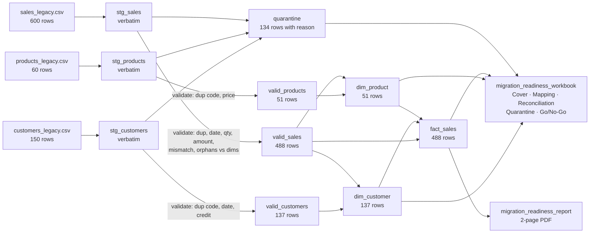

# P29 — Data Lineage (SAMPLE)

How every field in CloudERP traces back to the BillPro 2009 export — so that when a number in the new system looks wrong, the team can find exactly which legacy file, row and rule produced it.

## Flow

## Table lineage

| Target table | Source file | Rows in | Rows out | Rule |
|---|---|---|---|---|
| dim_customer | customers_legacy.csv | 150 | 137 | First occurrence per code; ISO date; numeric credit limit |
| dim_product | products_legacy.csv | 60 | 51 | First occurrence per normalised code; price above 0 |
| fact_sales | sales_legacy.csv | 600 | 488 | Clean row whose customer and product both migrated |
| quarantine | all three files | 810 | 134 | Every rejected row, with its reason |

## Column lineage (key columns)

| CloudERP column | Legacy source | Transform |
|---|---|---|
| dim_customer.cust_code | customers_legacy.cust_code | Kept as-is; unique |
| dim_customer.credit_limit_pkr | customers_legacy.credit_limit | Strip commas, cast to number |
| dim_customer.since_date | customers_legacy.since_date | DD/MM/YYYY, YYYY-MM-DD or DD-Mon-YYYY → ISO |
| dim_customer.status | customers_legacy.status | Active unless legacy says Inactive |
| dim_product.prod_code | products_legacy.prod_code | Upper-case, hyphens/spaces removed |
| dim_product.category | products_legacy.category | Blank → 'Uncategorised' |
| dim_product.unit_price_pkr | products_legacy.unit_price | Strip commas, cast to number |
| fact_sales.bill_date | sales_legacy.bill_date | Same date normalisation as customers |
| fact_sales.customer_key | sales_legacy.cust_code | Look up dim_customer by code |
| fact_sales.product_key | sales_legacy.prod_code | Normalise, then look up dim_product by code |
| fact_sales.amount_pkr | sales_legacy.amount | Strip commas, cast; must equal qty × unit price |
| fact_sales.tax_pkr | sales_legacy.tax | Strip commas, cast; blank → NULL |

## Deliberately NOT migrated

| Legacy column | Why it stays behind |
|---|---|---|
| products_legacy.stock_qty | A point-in-time count, not a master attribute. Copying it would freeze a stale stock figure into the new system. Stock must be physically counted at cutover. |

## How to trace a number

1. Find the row in `fact_sales` / `dim_customer` / `dim_product` (or in `outputs/quarantine.csv` if it never arrived).
2. Its source file and row number are in `quarantine.csv` (rejected rows) or in the staging tables `stg_*` (same row number as the source file).
3. The rule that accepted or rejected it is in `sql/mapping.sql` and in `src/run_migration.py` — one rule, one reason code.

